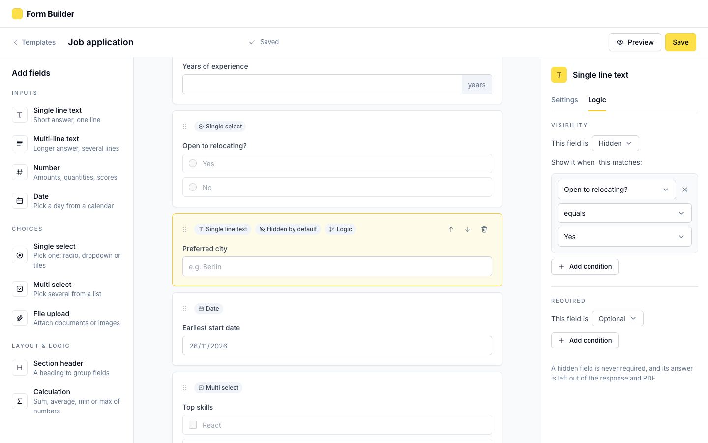
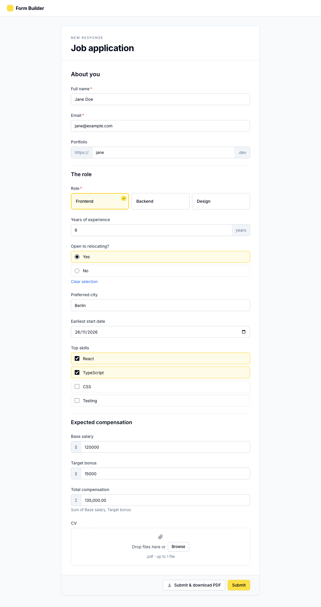
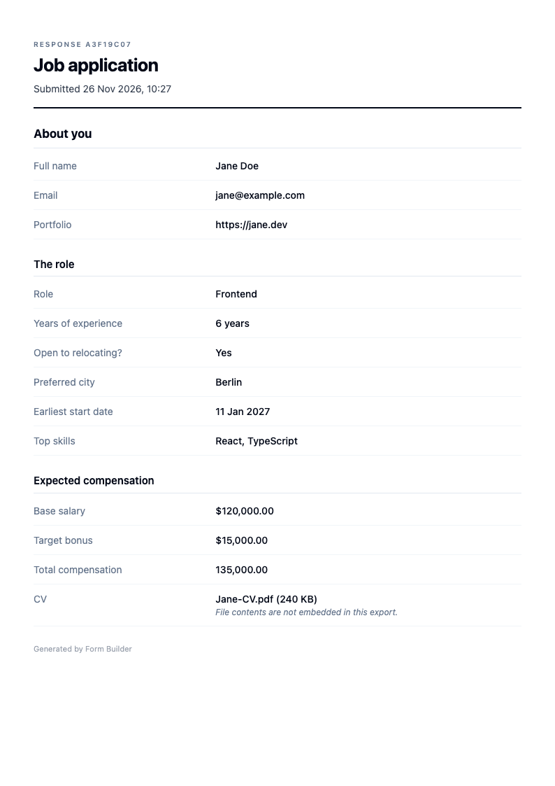
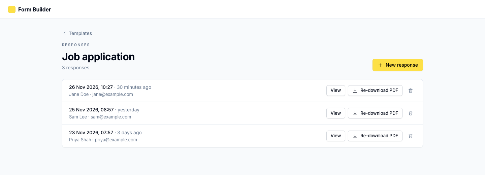

# Form Builder

A browser-only form builder. Build form templates in a three-panel builder, fill them in, and export responses as PDF. Fields can be shown, hidden or made required by rules on other fields, and calculation fields total up number fields as you type. Everything is stored in `localStorage`.

React 19 · TypeScript (strict) · Vite · react-router · zod · Vitest + Testing Library. No backend, no PDF library.



[Run it](#run-it) · [Using it](#using-it) · [Storage](#storage) · [Architecture](#architecture) · [Conditional logic](#conditional-logic) · [Calculation and PDF](#calculation-and-pdf) · [Trade-offs](#trade-offs) · [Decisions](#decisions) · [Testing](#testing) · [Improvements](#what-id-improve-with-more-time) · [How I worked](#how-i-worked)

---

## Run it

Requires Node `^20.19` or `>=22.12` (Vite 8). Developed on Node 24.

```bash
npm install
npm run dev        # http://localhost:5173
npm test           # unit + UI tests
npm run check      # typecheck + lint + tests
npm run build      # production build
```

## Using it

1. **New template**, or click a template card to edit one.
2. Add fields from the left panel (click or drag). Reorder them by dragging the handle or with ↑/↓.
3. Configure the selected field on the right: **Settings** for the field itself, **Logic** for show/hide and required rules.
4. **Preview** to try the form, including unsaved changes, then **Save**.
5. From the templates list, **New response** opens the form. **Submit & download PDF** saves it and opens the print dialog. **Responses** lists submissions, with View, Re-download PDF and Delete.

<table>
  <tr>
    <th>Filling in a form</th>
    <th>The exported PDF</th>
  </tr>
  <tr>
    <td></td>
    <td></td>
  </tr>
</table>



| Field type | What it does |
|---|---|
| Single line text | Placeholder, min/max length, prefix/suffix |
| Multi-line text | Visible rows, min/max length |
| Number | Min/max, 0–4 decimal places, prefix/suffix |
| Date | Optional pre-fill with today, min/max date |
| Single select | Radio, dropdown or tiles |
| Multi select | Min/max selections |
| File upload | Allowed extensions, max files (stores name, size and type only) |
| Section header | A heading in five sizes |
| Calculation | Sum, average, min or max of number fields, read-only |

Conditional logic isn't a field type: every field can have rules (see [Conditional logic](#conditional-logic)).

---

## Storage

Two `localStorage` keys, each holding an object of `id → record`:

```ts
'formBuilder:v1:templates' → {
  [templateId]: { id, title, fields: Field[], createdAt, updatedAt }
}

'formBuilder:v1:responses' → {
  [responseId]: {
    id, templateId, submittedAt,
    form: { title, fields: Field[] },     // copy of the form at submit time
    visibleFieldIds: FieldId[],           // fields the user could see, in order
    values: { [fieldId]: FieldValue }     // visible fields only, empty answers included
  }
}
```

- **Every record is validated with zod when it's read.** Invalid records are skipped (the app shows a notice) and left as they are on later saves, so one bad record never hides or deletes the others. If a whole key isn't valid JSON, it loads as empty and the next save replaces it.
- **A response keeps its own copy of the form,** so editing a template never changes old responses or their PDFs. I first planned template versioning; a copy gives the same guarantee with much less code. The cost is storage that grows with every response, within the browser's `localStorage` quota (usually about 5 MB).
- **The visible fields and calculated values are saved at submit,** so an export never re-runs the rules.
- **Types are inferred from the zod schemas,** so the stored shape and the TypeScript types can't drift apart. The `v1` in the keys leaves room for a migration.

---

## Architecture

```
pages/  →  builder/ · fill/ · export/  →  fields/ · engine/ · storage/  →  lib/ · ui/
```

Imports only point downwards. `engine/` and the field logic never import React.

| Folder | Contents |
|---|---|
| `fields/` | One folder per field type (schema, logic, settings panel, input, tests), plus the registries |
| `engine/` | Pure logic: rule evaluation, dependency order, validation, reference clean-up |
| `builder/` | The builder screen and its reducer |
| `fill/` | `FormFiller`, used by Fill Mode and by Preview |
| `export/` | Export model, document component, printing |
| `storage/` | zod schemas and reading/writing `localStorage` |

**Components and state**
- Pages read what they need from storage once and show "not found" for unknown ids.
- The builder keeps its state in a reducer (`builderReducer`) because one action often changes several things: deleting a field also moves the selection and removes the rules that used it. "Unsaved changes" isn't stored; it's worked out by comparing with the last saved template.
- `FormFiller` stores only what the user did. Visibility, required state, calculations and errors are recomputed by `evaluateForm` on every render, so they can't go stale. `FieldRow` draws a field the same way in Fill Mode, Preview and the builder canvas.

**Adding a field type**
1. Add a folder `fields/<type>/` with its schema, logic (a `FieldDefinition`), settings panel, input and tests.
2. Add one line to `fields/logicRegistry.ts` and one entry to `fields/uiRegistry.ts`.
3. Add its schemas to the lists in `fields/fieldUnion.ts`, and its value type to `FieldValueMap`.

Both registries are typed so that a missing entry is a compile error, and a test renders every registered type in the builder and in Fill Mode. Nothing outside `fields/` switches on the field type.

Rules are grouped by **operator family** (text, number, range, date, single select, multi select), not by field type. A new type that reuses a family, such as an Email field with text operators, needs no engine change. A new family needs a new case in the rule evaluator and the rule editor.

---

## Conditional logic

Each field has a **visibility** rule group and, for input fields, a **required** group. A group has a default state, ALL or ANY, and a list of conditions. When the group matches, the state flips to the opposite of its default, so "show" and "hide" can never conflict. The builder writes it as a sentence: *This field is [Hidden]. Show it when [all] of these match.* (The ALL/ANY picker appears once there are two conditions.)

`evaluateForm` works like this:
1. It evaluates fields in dependency order (rule targets and calculation sources first), so a field's position in the form doesn't matter.
2. A condition on a hidden, empty or deleted field never matches, for any operator. That makes chains work: if A hides B, then B counts as empty, so C (shown when B = "y") stays hidden.
3. Hidden fields are never required, and never appear in the submission or the PDF.
4. It runs on every render, so changes appear as you type.

The builder won't let a field use itself as a target or create a loop, and Save checks for loops as well.

---

## Calculation and PDF

**Calculation** adds up, averages, or takes the min or max of the visible, non-empty number fields it uses, and shows "—" if none have a value. Only number fields can be sources, so a calculation can't use another calculation. The result is saved with the response.

**PDF** is built only from the response's own copy of the form and its visible fields. One React component, `ExportDocument`, renders it:
- in the app, on the response view page;
- for printing, as HTML in a hidden iframe (via `renderToStaticMarkup`, loaded only when printing). The print dialog opens and the user picks "Save as PDF".

The document has a header (title, submission time, short response reference), section headings, label and value rows, "—" for empty answers, and page numbers in browsers that support them. File contents can't be included, so files are listed by name and size with a note saying so.

---

## Trade-offs

| Choice | Why | Cost |
|---|---|---|
| react-router | Every screen has a URL, so a refresh keeps your place; its `useBlocker` powers the unsaved-changes prompt | One dependency |
| zod | Validates stored data at runtime, with TypeScript types inferred from the same schemas | One dependency |
| PDF via the print dialog | No PDF library (spec), real typography, any language | One extra click |
| Native drag-and-drop | No library | Not touch-friendly; the ↑/↓ buttons work everywhere |
| Recomputing rule results on every render | Results can't go stale | Repeated work, negligible at form sizes |
| A full form copy per response | Old responses never change | Storage grows with responses |

**Type safety.** Strict TypeScript, no `any`. Fields and conditions are discriminated unions, and display-only fields (section header, calculation) have no `required` property, so they can't be made required. The only type casts are four commented lines in the field registry, where TypeScript can't link a field to its type's definition.

---

## Decisions

Where the spec left room for interpretation:

**Rules**
- Text comparisons ignore case and surrounding spaces. "Is within range" includes both ends.
- Rule targets follow the spec's operator table. File upload, section header and calculation can't be targets.
- A hidden field keeps what was typed and restores it if shown again. It's never submitted.
- Hiding a section header hides only the header, not the fields after it.

**Builder**
- Deleting a field or option that rules use asks first, then removes those rules. Options have stable ids, so renaming one is safe.
- A field's type can't be changed after it's added, and invalid settings block Save.
- Leaving with unsaved changes asks first. Preview shows unsaved changes, never saves, and the browser's Back button closes it.

**Filling in**
- Errors appear after you leave a field or try to submit, then update as you type.
- Text that is only spaces counts as empty. An optional field left empty skips its other rules.
- Max length stops typing. A multi select at its maximum disables the remaining options. File upload accepts only the listed extensions.
- Numbers round half away from zero when you leave the field and again before saving.
- Pre-filling today's date still happens when today is outside the allowed range; the field then shows the range error.

**Responses**
- Nothing is saved before Submit (no drafts). After Submit you land on the responses list with the new response highlighted.
- A PDF is only offered for a submitted response, because it needs a submission time.
- You can view and delete single responses. Deleting or duplicating templates is out of scope.

---

## Testing

262 tests in 35 files, next to the code they cover:
- **Rules and calculations** (written test-first from the spec): every operator, ALL/ANY, chained rules, hidden required fields, loops, deleted targets, calculation results.
- **Field types and storage:** defaults, validation, export formatting, invalid stored data.
- **UI behaviour:** building, reordering and saving a form; fields showing and hiding live; submitting with a hidden required field; a calculation updating as you type; the three single select displays; the responses list and PDF actions.

I also checked the PDF output by rendering it to a real file in headless Chrome.

---

## What I'd improve with more time

- **A one-click PDF download.** Generate the PDF bytes directly to skip the print dialog. That's much more code and only handles Latin text, which is why I used the print dialog.
- **Drafts / autosave** of half-filled responses, and **template delete/duplicate** (duplicating means remapping field ids inside rules and calculation sources).
- **"is empty" / "is not empty" operators**, and calculations as rule targets.
- **Dark mode** (colours are already CSS variables).
- Performance for very large forms: `evaluateForm` re-runs on every keystroke. It's instant at realistic sizes but could be memoised.

---

## How I worked

[`docs/SPEC.md`](docs/SPEC.md) (resolved spec), [`docs/INTERVIEW.md`](docs/INTERVIEW.md) (the spec Q&A) and [`docs/PLAN.md`](docs/PLAN.md) (build plan) show how I worked. AI usage is described in [`AI_USAGE_LOG.md`](AI_USAGE_LOG.md).
